# Service Layer Flows

Business-logic flowcharts for every `*.service.ts` module in `server/src/modules/`,
plus the end-to-end journey of the core feature: **shorten a URL, resolve it, count
the click**. §0 is the one-page map of the whole system; §1–§8 drill into each
area.

**Scope:** service layer only. Controllers, repositories, cache, Redis and Postgres
appear as *boundary* nodes — the shape of an external call — but routing, request
parsing, response serialisation and status-code mapping are deliberately out of
scope. Where a service throws, the diagram shows the `ApiError` code; translating
that into HTTP is the controller's job.

**Source of truth:** `server/src`. Every node outside §0 carries a `file:line`
reference so a diagram can be traced back to the code that implements it.

---

## Legend

| Shape / colour | Meaning |
| --- | --- |
| `["…"]` | In-process step — including the service entry point |
| `{"…"}` | Branch / business rule |
| `(["…"])` | Terminal node — a request entering, or an outcome leaving (`201`, `404`, …) |
| `[("…")]` | Persistent store: Postgres or Redis |
| Red node | Terminal error — an `ApiError` that aborts the request (red fill in the diagram) |
| Green node | Terminal success — value returned to the controller (green fill in the diagram) |

Diagrams render natively on GitHub, GitLab and the VS Code "Mermaid Preview" /
"Markdown Preview Mermaid Support" extensions.

---

# 0. All-in-one overview

One picture of the whole system: the request pipeline and its **RBAC** and
**plan** gates, auth, links CRUD, the cached redirect plus the click pipeline,
billing, admin moderation and stats.

Labels here are deliberately terse — this diagram carries no `file:line` refs.
§1–§8 below expand each area with the exact branch detail and code references.

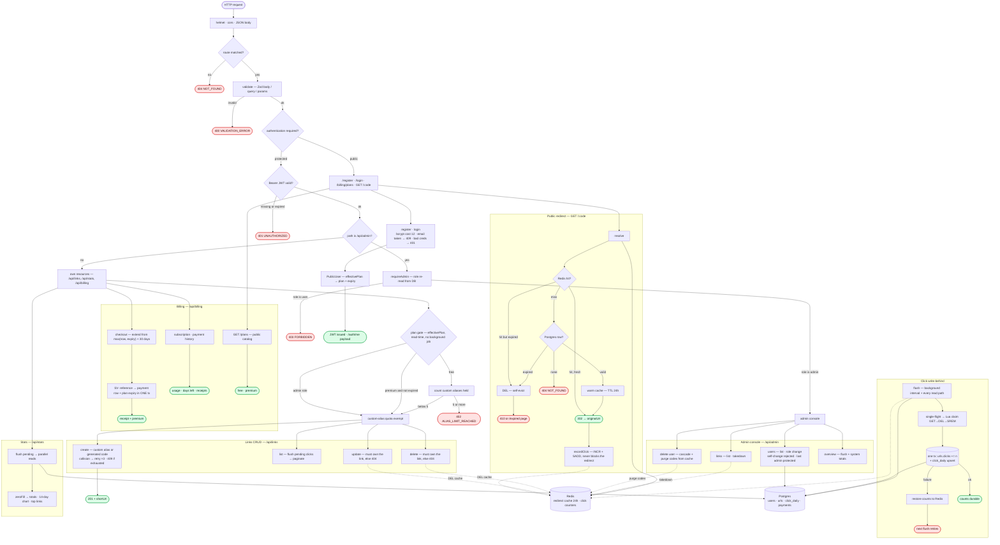

---

# 1. Main feature — shorten URL, end to end

The feature spans three concerns, each documented below:

1. **Create** — `POST /api/links` → quota check → insert → short URL returned.
2. **Resolve** — `GET /:code` → Redis cache → Postgres fallback → `302`.
3. **Count** — click written to Redis, then flushed to Postgres by a
   crash-safe write-behind job.

## 1.1 Create a short link

`server/src/modules/links/links.service.ts:49`

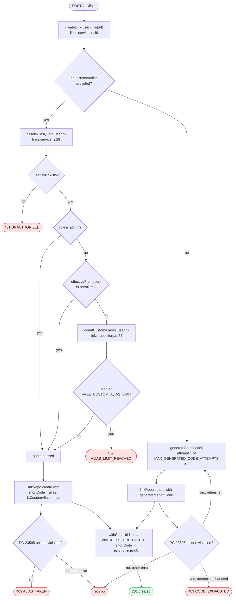

Notes:

- The quota is evaluated on **create only** — aliases already in use keep working
  after a plan lapses.
- `assertAliasQuota` reads the plan from the database (not the session), so a
  premium row whose `plan_expires_at` has passed is gated immediately.
- No cache write happens on create: the redirect cache is populated lazily on the
  first resolve (§1.2).

## 1.2 Resolve a short code

`server/src/modules/redirect/redirect.service.ts:34`

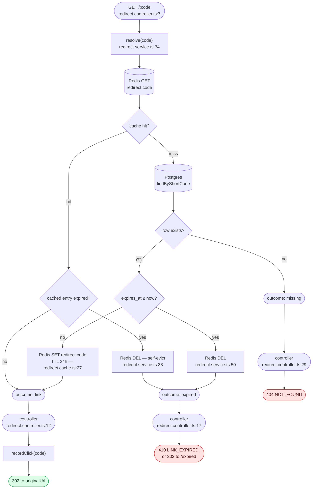

Notes:

- Every branch ends in an explicit outcome so the controller never has to
  interpret a `null`.
- The cache entry stores `{ originalUrl, expiresAt }`, which lets the hot path
  detect expiry **without** touching Postgres.
- `redirect.cache.ts` swallows Redis errors (`get` → `null`, `set`/`del` → no-op),
  so a Redis outage degrades to a direct database read rather than a 500.

## 1.3 Counting clicks — write-behind flush

`recordClick` (write) and `flushPendingClicks` (drain) in
`server/src/modules/redirect/redirect.service.ts`

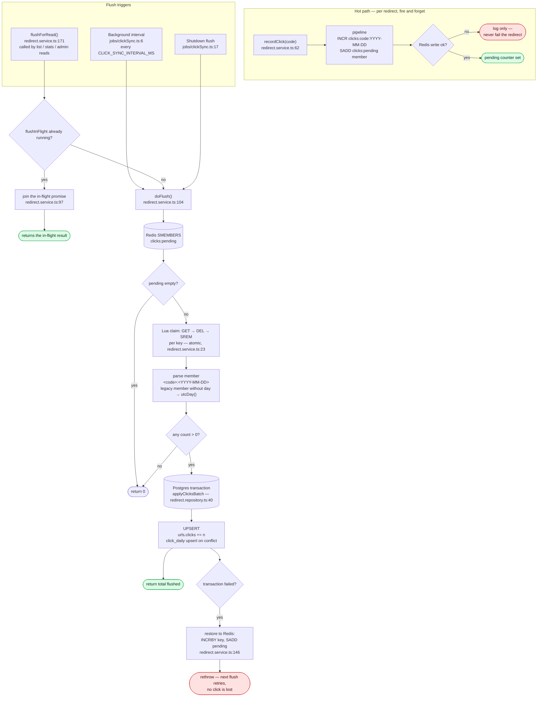

Notes:

- **Claim before write:** the Lua script moves counts out of Redis only after
  capturing them; the DB transaction is the point of no return.
- **Restore on failure:** if Postgres rejects the batch, every claimed count is
  written back, so the next interval retries instead of dropping data.
- **Single-flight:** concurrent calls share one promise, so a burst of reads
  cannot pile up flushes.
- **`flushForRead` is best-effort:** it logs and swallows errors so list/stats
  responses still succeed with slightly stale counts.

---

# 2. `auth` — register / login / current user

`server/src/modules/auth/auth.service.ts`

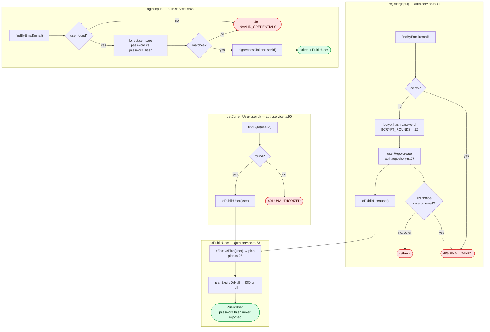

Notes:

- Unknown email and wrong password return the **identical** error, so the
  endpoint cannot be used to enumerate accounts.
- `toPublicUser` projects through `effectivePlan`, so a lapsed premium account
  reports `plan: "free"` on `/auth/me` without any write.

---

# 3. `links` — CRUD + quota

`server/src/modules/links/links.service.ts`

```mermaid
flowchart TD
  subgraph CREATE["createLink — links.service.ts:49"]
    C1["custom alias → assertAliasQuota<br/>generated → 3-attempt loop"] --> C2["insert, map 23505<br/>to ALIAS_TAKEN / CODE_EXHAUSTED"]
    C2 --> C3(["withShortUrl → 201"])
    C1 -.->|"expanded"| SEE1["see §1.1"]
  end

  subgraph LIST["listLinks — links.service.ts:90"]
    A1["flushForRead()<br/>pull Redis counts into PG first"] --> A2["listByUserId<br/>offset = page-1 × pageSize"]
    A2 --> A3["totalPages = ceil(total / pageSize)<br/>hasNext = page < totalPages"]
    A3 --> A4(["items with shortUrl + meta"])
  end

  subgraph UPD["updateLink — links.service.ts:118"]
    U1["findOwnedById(linkId, userId)"] --> U2{"found?"}
    U2 -->|"no"| UE(["404 NOT_FOUND"])
    U2 -->|"yes"| U3["update originalUrl, expiresAt"]
    U3 --> U4[("Redis DEL<br/>redirect:shortCode")]
    U4 --> U5(["withShortUrl → 200"])
  end

  subgraph DEL["deleteLink — links.service.ts:138"]
    D1["findOwnedById(linkId, userId)"] --> D2{"found?"}
    D2 -->|"no"| DE(["404 NOT_FOUND"])
    D2 -->|"yes"| D3["linkRepo.remove — cascade<br/>drops click_daily rows"]
    D3 --> D4[("Redis DEL<br/>redirect:shortCode")]
      D4 --> D5(["204 no content"])
    end

  classDef err fill:#fee2e2,stroke:#dc2626,color:#450a0a
  classDef ok fill:#dcfce7,stroke:#16a34a,color:#052e16
  class UE,DE err
  class C3,A4,U5,D5 ok
```

Notes:

- `flushForRead()` on the list path means the table shows near-real-time click
  counts instead of waiting for the background interval.
- Update and delete both purge the redirect cache, so a removed link stops
  resolving on the very next request even though its cache entry still has
  TTL left.
- Ownership is enforced by every query taking `(linkId, userId)` — a foreign
  link is indistinguishable from a missing one (both `404`).

---

# 4. `redirect` — resolve, count, flush

`server/src/modules/redirect/redirect.service.ts`

```mermaid
flowchart TD
  subgraph RES["resolve(code) — redirect.service.ts:34"]
    R1["cache get → hit?"] --> R2{"expired?"}
    R2 -->|"yes"| RX1(["DEL → expired"])
    R2 -->|"no"| RL(["link"])
    R1 -->|"miss"| R3["findByShortCode"] --> R4{"row / expiry?"}
    R4 -->|"missing"| RM(["missing"])
    R4 -->|"expired"| RX1
    R4 -->|"valid"| RS["cache set, TTL 24h"] --> RL
    R1 -.-> SEE["see §1.2"]
  end

  subgraph REC["recordClick — redirect.service.ts:62"]
    K1["pipeline INCR + SADD<br/>bucket by UTC day"] --> K2{"redis ok?"}
    K2 -->|"no"| KE(["log, swallow"])
    K2 -->|"yes"| KO(["queued"])
  end

  subgraph FLU["flushPendingClicks / doFlush — redirect.service.ts:96, 104"]
    F1{"flushInFlight?"} -->|"yes"| F2["return in-flight promise"]
    F1 -->|"no"| F3["SMEMBERS clicks:pending"]
    F3 --> F4{"empty?"} -->|"yes"| FZ(["0"])
    F4 -->|"no"| F5["Lua GET→DEL→SREM claim"]
    F5 --> F6["parse code + day<br/>legacy member → utcDay()"]
    F6 --> F7{"counts > 0?"} -->|"no"| FZ
    F7 -->|"yes"| F8[("transaction:<br/>urls.clicks += n<br/>click_daily upsert")]
    F8 --> F9(["total flushed"])
    F8 --> F10["failure → INCRBY + SADD restore<br/>then rethrow"] --> F11(["retry next cycle"])
  end

  subgraph FR["flushForRead — redirect.service.ts:171"]
    B1["await flushPendingClicks()"] --> B2{"threw?"}
    B2 -->|"yes"| B3(["log only — caller request survives"])
      B2 -->|"no"| B4(["counts now current"])
    end

  classDef err fill:#fee2e2,stroke:#dc2626,color:#450a0a
  classDef ok fill:#dcfce7,stroke:#16a34a,color:#052e16
  class RX1,RM,KE,F11,B3 err
  class RL,KO,F9,B4 ok
```

---

# 5. `billing` — subscription + simulated checkout

`server/src/modules/billing/billing.service.ts`

```mermaid
flowchart TD
  subgraph CO["checkout(user, input) — billing.service.ts:95"]
    C1{"input.plan is premium?"} -->|"no"| CE(["400 UNSUPPORTED_PLAN"])
    C1 -->|"yes"| C2{"effectivePlan(user)<br/>is premium?"}
    C2 -->|"yes"| C3["base = max(now,<br/>current plan_expires_at)"]
    C2 -->|"no"| C4["base = now"]
    C3 --> C5["planExpiresAt = base + 30 days<br/>PREMIUM_DURATION_MS"]
    C4 --> C5
    C5 --> C6["reference = SV-xxxxxxxx"]
    C6 --> C7[("purchasePremium transaction<br/>billing.repository.ts:43")]
    C7 --> C8["insert payments row<br/>+ update users.plan_expires_at<br/>atomically"]
    C8 --> C9(["receipt + subscription"])
  end

  subgraph SUB["getSubscription(user) — billing.service.ts:66"]
    S1["effectivePlan(user)"] --> S2["PLAN_CATALOG lookup"]
    S2 --> S3["countCustomAliases(user.id)"]
    S3 --> S4{"role is admin?"}
    S4 -->|"yes"| S5["customAliasLimit = null<br/>unlimited"]
    S4 -->|"no"| S6["customAliasLimit from catalog"]
    S5 --> S7(["plan, daysRemaining, usage"])
    S6 --> S7
  end

  subgraph OTHER["listPlans / listPayments — billing.service.ts:85, 127"]
    O1["listPlans() → PLAN_CATALOG"] --> O2(["static catalog,<br/>no plans table"])
    O3["listPayments(userId)"] --> O4["map to PaymentView<br/>amount formatted as currency"]
  end

  subgraph EP["effectivePlan — plan.ts:26"]
    E1{"plan is premium?"} -->|"no"| EF(["free"])
    E1 -->|"yes"| E2{"plan_expires_at set?"}
    E2 -->|"no"| EF
    E2 -->|"yes"| E3{"expires_at > now?"}
    E3 -->|"no"| EF
      E3 -->|"yes"| EG(["premium"])
    end

  classDef err fill:#fee2e2,stroke:#dc2626,color:#450a0a
  classDef ok fill:#dcfce7,stroke:#16a34a,color:#052e16
  class CE err
  class C9,S7,O2,O4,EG ok
```

Notes:

- **Renewal extends, never shortens:** `base = max(now, currentExpiry)` means a
  user who renews early keeps the days they already paid for.
- Payment row and plan change are written in **one transaction**, so a crash can
  never leave a paid user un-upgraded or an upgrade without a receipt.
- `effectivePlan` is pure read-time logic — no background job, no destructive
  write. A premium row past its expiry simply reads as free everywhere.

---

# 6. `stats` — dashboard + per-link analytics

`server/src/modules/stats/stats.service.ts`

```mermaid
flowchart TD
  subgraph OV["getOverview(userId, days) — stats.service.ts:42"]
    O1["flushForRead()"] --> O2["compute today + fromDay<br/>dayOffset(days-1)"]
    O2 --> O3["Promise.all<br/>getTotals, getSeries, getTopLinks"]
    O3 --> O4["zeroFill(fromDay, series)"]
    O4 --> O5(["totals + dense series + top 5 links"])
  end

  subgraph LS["getLinkStats(userId, linkId, days) — stats.service.ts:60"]
    L1["flushForRead()"] --> L2["findOwnedById(linkId, userId)"]
    L2 --> L3{"found?"}
    L3 -->|"no"| LE(["404 NOT_FOUND"])
    L3 -->|"yes"| L4["Promise.all<br/>getLinkSeries, getLinkClicksToday"]
    L4 --> L5["zeroFill — every bucket present"]
    L5 --> L6["clicksInRange = Σ series<br/>peakDayClicks = max(series)"]
    L6 --> L7["daysActive = ceil(age / 1 day), min 1"]
    L7 --> L8["avgPerDay = round(clicks / daysActive)"]
    L8 --> L9(["link + stats + series"])
  end

  subgraph ZF["zeroFill — stats.service.ts:20"]
    Z1["Map of day → clicks"] --> Z2["iterate every UTC day<br/>from fromDay to today"]
      Z2 --> Z3(["missing day → 0"])
    end

  classDef err fill:#fee2e2,stroke:#dc2626,color:#450a0a
  classDef ok fill:#dcfce7,stroke:#16a34a,color:#052e16
  class LE err
  class O5,L9,Z3 ok
```

Notes:

- `zeroFill` makes the chart dense: days with no rows still produce a bucket,
  so the graph never has gaps.
- Totals come from `urls.clicks` (the denormalized column), while the series
  comes from `click_daily` — the flush in §1.3 keeps them consistent.

---

# 7. `admin` — moderation + system overview

`server/src/modules/admin/admin.service.ts`

```mermaid
flowchart TD
  subgraph LU["listUsers / listLinks — admin.service.ts:56, 128"]
    A1["listLinks: flushForRead() first"] --> A2["query with page, pageSize, search"]
    A2 --> A3["meta(page, pageSize, total)<br/>totalPages, hasNext"]
    A3 --> A4(["items + meta"])
  end

  subgraph UR["updateUserRole — admin.service.ts:72"]
    R1{"actorId == targetId?"} -->|"yes"| RE(["400 CANNOT_CHANGE_OWN_ROLE"])
    R1 -->|"no"| R2["findUserById(targetId)"]
    R2 --> R3{"found?"} -->|"no"| RN(["404 NOT_FOUND"])
    R3 -->|"yes"| R4{"demoting an admin?"}
    R4 -->|"yes"| R5["countAdmins()"]
    R5 --> R6{"≤ 1 admin left?"}
    R6 -->|"yes"| RL(["400 LAST_ADMIN"])
    R6 -->|"no"| R7["updateUserRole → toPublicUser"]
    R4 -->|"no"| R7
    R7 --> ROK(["updated PublicUser"])
  end

  subgraph DU["deleteUser — admin.service.ts:103"]
    D1{"actorId == targetId?"} -->|"yes"| DE(["400 CANNOT_DELETE_SELF"])
    D1 -->|"no"| D2["findUserById(targetId)"] --> D3{"found?"}
    D3 -->|"no"| DN(["404 NOT_FOUND"])
    D3 -->|"yes"| D4{"target is admin<br/>and countAdmins ≤ 1?"}
    D4 -->|"yes"| DL(["400 LAST_ADMIN"])
    D4 -->|"no"| D5["listUserShortCodes(targetId)"]
    D5 --> D6[("deleteUser — FK cascade<br/>removes urls, click_daily, payments")]
    D6 --> D7[("DEL every redirect:shortCode")]
    D7 --> D8(["204 no content"])
  end

  subgraph DL2["deleteLink — admin.service.ts:146"]
    N1["findLinkById(linkId)"] --> N2{"found?"}
    N2 -->|"no"| NE(["404 NOT_FOUND"])
    N2 -->|"yes"| N3["removeLink — cascade"]
    N3 --> N4[("DEL redirect:shortCode")]
    N4 --> N5(["204 no content"])
  end

  subgraph GO["getOverview — admin.service.ts:156"]
    G1["flushForRead()"] --> G2["today, fromDay,<br/>newUsersSince = now - 7 days"]
    G2 --> G3["Promise.all<br/>getSystemTotals, getSystemSeries, getTopLinks"]
    G3 --> G4["zeroFill(series)"]
      G4 --> G5(["system totals + series + top 5"])
    end

  classDef err fill:#fee2e2,stroke:#dc2626,color:#450a0a
  classDef ok fill:#dcfce7,stroke:#16a34a,color:#052e16
  class RE,RN,RL,DE,DN,DL,NE err
  class ROK,D8,N5,G5,A4 ok
```

Notes:

- Guard rails (`CANNOT_CHANGE_OWN_ROLE`, `LAST_ADMIN`, `CANNOT_DELETE_SELF`)
  are enforced in the service so no route can bypass them.
- Deleting a user collects short codes **before** the cascade delete, then
  purges each redirect cache entry — otherwise a code could keep resolving
  from cache for up to 24 h.
- Admin reads flush pending clicks first, so the overview reflects live traffic.

---

# 8. Cross-cutting

## 8.1 Where pending clicks are flushed

| Caller | File:line | Behaviour |
| --- | --- | --- |
| Background interval | `jobs/clickSync.ts:6` | every `CLICK_SYNC_INTERVAL_MS`, `unref()`'d |
| Shutdown | `jobs/clickSync.ts:17` | final flush on SIGTERM/SIGINT |
| `links.listLinks` | `links/links.service.ts:96` | best-effort, log on failure |
| `stats.getOverview` | `stats/stats.service.ts:43` | best-effort |
| `stats.getLinkStats` | `stats/stats.service.ts:61` | best-effort |
| `admin.listLinks` | `admin/admin.service.ts:129` | best-effort |
| `admin.getOverview` | `admin/admin.service.ts:157` | best-effort |

All of them funnel through the single-flight `flushPendingClicks()`, so a burst
of concurrent reads runs exactly one flush.

## 8.2 Where the redirect cache is invalidated

| Site | File:line | Why |
| --- | --- | --- |
| `links.updateLink` | `links/links.service.ts:133` | target URL or expiry changed |
| `links.deleteLink` | `links/links.service.ts:145` | link removed |
| `admin.deleteLink` | `admin/admin.service.ts:153` | moderation takedown |
| `admin.deleteUser` | `admin/admin.service.ts:125` | purge every code the user owned |
| `redirect.resolve` (stale entry) | `redirect/redirect.service.ts:38` | cached entry already expired |
| `redirect.resolve` (expired row) | `redirect/redirect.service.ts:50` | DB row expired after being cached |

There is deliberately **no** cache write on create — entries are populated
lazily by the first resolve and expire naturally after `CACHE_TTL_SECONDS` (24 h).

## 8.3 Store touchpoints

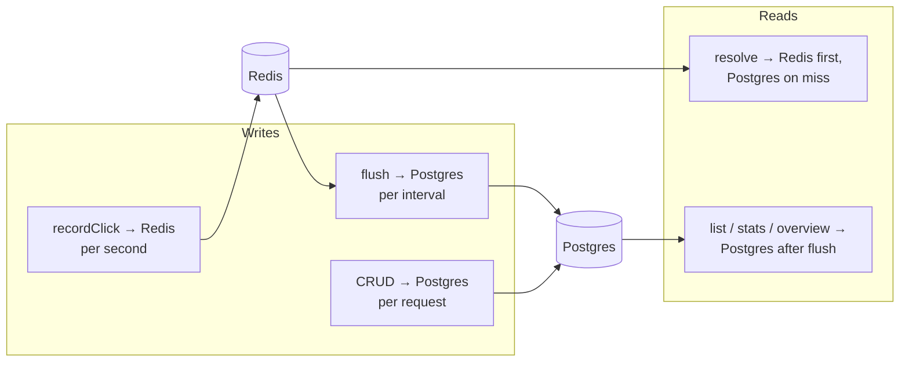
